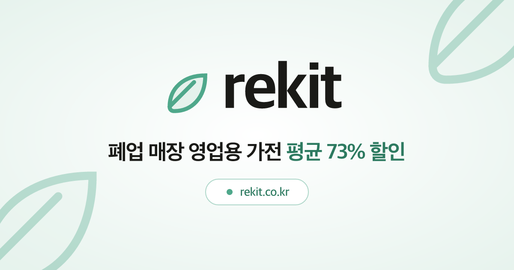

<h2 align="center">안녕하세요, 백엔드 개발자 박진은입니다 👋</h2>

문제의 원인을 끝까지 추적해 구조로 해결하고, 장애에 강하고 운영하기 쉬운 서버를 만듭니다.

  
  
  
  

---

### 👨‍💻 About

- **헬스케어 IT 기업 백엔드 엔지니어** (2024.06 ~ 2026.04, 1년 11개월)
  - 일 최대 3천만 건의 로그가 쌓이는 해외 대규모 레거시 시스템의 운영과 장애 대응
  - 헬스케어 서비스 백엔드와 외부 기관 표준 API 연동 (Spring Boot 3, Redis, NCP)
- **rekit 1인 개발** (2026.05 ~ 현재) · 🔗 **https://rekit.co.kr**
  - 업소용 중고 가전 거래 플랫폼. 기획부터 백엔드, 인프라, 배포, 모니터링까지 혼자 맡고 있습니다.

### 🚀 Featured Project

#### rekit · 업소용 중고 가전 거래 플랫폼

<!-- 북마크 카드: assets/rekit-preview.png 에 사이트 첫 화면 캡처(가로 1200px 정도)를 올려 두세요 -->
<table>
  <tr>
    <td width="260">
      
    </td>
    <td>
      <a href="https://rekit.co.kr"><b>rekit — 업소용 중고 가전 거래</b></a> 
      폐업 매장에서 나온 업소용 가전을 상태 등급과 동작 보증 정보로 표준화해 거래하는 서비스  
      
      <a href="https://rekit.co.kr"><code>rekit.co.kr</code></a>
        
      
    </td>
  </tr>
</table>
<!-- 저장소가 공개라면 링크를 추가하세요: [GitHub](https://github.com/JinEunPark/REPO) -->

폐업 매장에서 나온 업소용 가전을 상태 등급과 동작 보증 정보로 표준화해 거래하는 서비스입니다.

<!-- 2단계(W3~W9) 완료 후 추가
#### [rekit-order](https://github.com/JinEunPark/rekit-order) · 주문·결제 도메인 Spring Boot 재구현
Java 21 · Spring Boot 3 · JPA · AWS(EC2, RDS, SQS) · k6
- 주문 API p95 ○○ms → ○○ms
-->

### 🛠 Tech Stack

**Backend** 

<!-- W4 이후:  -->

**Data** 

**Infra & DevOps** 

<!-- W6 이후:   -->

**Monitoring & Test** 

